# Component Inventory: Nimbus Salvagers

## 1. Architectural Component Hierarchy

```mermaid
graph TD
    GameApp["GameApp (Root Component: A4)"]
    GameApp --> WorldContainer["WorldContainer (div.world-container)"]
    WorldContainer --> ThreeCanvas["ThreeCanvas (WebGL2 Canvas / Engine: y4)"]
    GameApp --> MenuShell["MenuShell (div.menu-shell: x4)"]
    GameApp --> CombatHUD["CombatHUD (div.game-hud)"]
    GameApp --> ModalLayer["ModalLayer (Dialog Container: Ms)"]
    GameApp --> ToastNotification["ToastNotification (div.toast)"]
    GameApp --> ErrorOverlay["ErrorOverlay (div.error-overlay)"]

    MenuShell --> TopBar["TopBar (header.topbar)"]
    TopBar --> WordmarkLogo["WordmarkLogo (button.wordmark)"]
    TopBar --> MainNav["MainNav (nav.main-nav)"]
    TopBar --> HeaderStatus["HeaderStatus (div.header-status)"]

    MenuShell --> PlayScreen["PlayScreen (main.play-menu)"]
    PlayScreen --> HeroSection["HeroSection (section.hero-copy)"]
    PlayScreen --> TrackedMissionCard["TrackedMissionCard (aside.mission-brief)"]
    PlayScreen --> EngineerCard["EngineerCard (button.engineer-tile)"]
    PlayScreen --> ActivitiesGrid["ActivitiesGrid (section.activities-section)"]

    MenuShell --> DestinationsScreen["DestinationsScreen (main.destinations-menu)"]
    DestinationsScreen --> PlanetPorthole["PlanetPorthole (div.planet-porthole)"]
    DestinationsScreen --> MissionList["MissionList (div.missions-list)"]

    MenuShell --> EngineerScreen["EngineerScreen (main.engineer-menu)"]
    EngineerScreen --> SubclassSelector["SubclassSelector (div.class-tabs)"]
    EngineerScreen --> SubclassStats["SubclassStats (div.class-stats)"]
    EngineerScreen --> LoadoutSelector["LoadoutSelector (div.loadout-panel)"]

    MenuShell --> CollectionsScreen["CollectionsScreen (main.collections-menu)"]
    CollectionsScreen --> CollectionGrid["CollectionGrid (div.collections-grid)"]

    MenuShell --> FooterBar["FooterBar (footer.bottom-bar)"]
    FooterBar --> RankBadge["RankBadge (div.rank-badge)"]
    FooterBar --> ControlLink["ControlLink (button.control-link)"]
    FooterBar --> SoundButton["SoundButton (button.sound-button)"]

    ModalLayer --> SettingsModal["SettingsModal"]
    ModalLayer --> ControlsModal["ControlsModal"]
    ModalLayer --> BriefingModal["BriefingModal"]
    ModalLayer --> ItemDetailModal["ItemDetailModal"]
    ModalLayer --> PauseModal["PauseModal"]
```

---

## 2. Core UI Component Specifications

### 2.1. `GameApp` (`A4`)
- **Role:** Top-level application coordinator, state store, and lifecycle manager.
- **State Hooks:**
  - `profile` (`o, u`): Persistent player data (engineer subclass, equipped weapon, unlocked IDs, tokens, settings).
  - `screen` (`d, m`): Active lobby view (`"play"` | `"destinations"` | `"engineer"` | `"collections"`).
  - `mode` (`v, S`): Selected activity mode (`"story"` | `"strike"` | `"windtrials"`).
  - `hud` (`p, z`): Real-time telemetry from Three.js game loop.
  - `isReady` (`x, E`): Canvas initialization readiness boolean.
  - `previews` (`_, O`): Dictionary of data URLs for rendered 3D mission thumbnails.
  - `activeModal` (`U, V`): Currently open dialog identifier.
  - `error` (`K, he`): Error string (e.g. WebGL context loss).
  - `toast` (`ye, We`): Temporary toast feedback string (e.g. `"Coil Nine equipped"`).
- **Public API Bindings:** Exposes `window.__NIMBUS_STATE__` and `window.__REVISION_STATE__` for runtime observability and automation.

### 2.2. `TopBar`
- **DOM Container:** `<header class="topbar flex items-center justify-between">`
- **Subcomponents:**
  - **`Wordmark`:** `<button class="wordmark flex items-center" aria-label="Nimbus Salvagers home">`  
    Contains text `"NIMBUS"`, vector airship balloon logo `<svg viewBox="0 0 48 48">`, and `SALVAGERS`. Clicking resets active screen to `"play"`.
  - **`MainNav`:** `<nav class="main-nav flex items-center" aria-label="Main navigation">`  
    Contains 4 buttons: `play`, `destinations`, `engineer`, `collections`. Active button receives `.active` class and contains `` which renders a bottom diamond indicator and coral glow.
  - **`HeaderStatus`:** `
`  
    Displays pulse indicator dot + `"SYSTEM ONLINE"`, diamond currency icon + Power level (`1750 + Math.floor(xp / 200)`), and settings gear button.

### 2.3. `PlayScreen` (`s === "play"`)
- **`HeroSection`:**
  - Episode badge: `◆ EPISODE 01 —— ECHOES OF THE FIRST ASCENT`
  - Heading: `RIDE THE UPDRAFT.`
  - Subtitle: `"The stars are calling, Engineer. Your next adventure begins on Cirrus Reach."`
  - Action Button: `<button class="launch-button">` with play icon, text `"LAUNCH MISSION"`, and right arrow.
  - Footer meta: ` FREE TO PLAY / WEATHER WINDOW OPEN`
- **`TrackedMissionCard`:**
  - Header: `"TRACKED MISSION"` and counter `"01 / 03"`.
  - Icon: SVG emblem of current mode (`Vl`).
  - Title: `${label} · CHAPTER 01` / `${title}`.
  - Description: Mission synopsis paragraph.
  - Button: `"VIEW MISSION DETAILS ↗"` (opens briefing modal).
- **`EngineerCard` (`button.engineer-tile`):**
  - Displays engineer emblem, title `"YOUR ENGINEER"`, subclass name `"Rigger"`, and element tag `"◆ Thermal subclass"`.
- **`ActivitiesGrid`:**
  - Title bar: `"CHOOSE YOUR NEXT ADVENTURE"` with `"VIEW DESTINATIONS →"` button.
  - 3 Cards:
    1. The Beryl Signal (Story / Campaign)
    2. Through the Squall (Cooperative / AI Fireteam)
    3. Trial by Wind (Competitive / Wind Trials)
  - Selected card receives `.selected` class with coral border and orange underline.

### 2.4. `DestinationsScreen` (`s === "destinations"`)
- **Header:** `"THE CIRRUS REACH"` / `"CHOOSE YOUR PATH."` / `"Every signal is the beginning of a story. Where will yours lead?"`
- **Left Planet Porthole:** Circular masked image of Cirrus Reach with rotating dashed orbit rings, orbital nodes, and caption `"CIRRUS REACH / THE CLOUD SEA / BERYL SINK ■ SIGNAL DETECTED"`.
- **Right Mission Cards:** 3 detailed cards with mission emblem, mode tag, title, objectives, duration (`5-8 MIN`, `7-10 MIN`, `4 MIN`), team size, and difficulty rating.

### 2.5. `EngineerScreen` (`s === "engineer"`)
- **Subclass Tabs:**
  - 3 Buttons: `RIGGER` (Wheel icon), `AEROSTAT` (Balloon icon), `MISTWRIGHT` (Current icon).
- **Subclass Stats & Abilities:**
  - Title: `${title} / ${element}`
  - Stat bars: `Mobility` (95), `Resilience` (55), `Recovery` (70) using animated `
`.
  - Abilities: Class Ability [Q] and Super Ability [F].
- **Center 3D Character Viewport:** Three.js camera zooms into the 3D player model. Model slowly breathes and rotates smoothly.
- **Kinetic Loadout Panel:**
  - Weapon slots: `Coil Nine` (Auto Rifle), `Rainbell` (Hand Cannon), `Longdraft` (Scout Rifle).
  - Armor slot: `Pathfinder Set` (Legendary).
  - Action button: `"READY TO DEPLOY →"`.

### 2.6. `CollectionsScreen` (`s === "collections"`)
- **Header:** `"THE STORIES YOU CARRY"` / `"YOUR COLLECTION."` / Counter `"02 / 06 DISCOVERED"`.
- **6-Item Codex Grid:**
  - 3 Weapons: Coil Nine (Unlocked), Rainbell (Locked), Longdraft (Locked).
  - 1 Armor: Pathfinder Set (Unlocked).
  - 1 Emblem: Trial by Wind (Locked).
  - 1 Mastery Seal: Cloudwright (Locked - requires completing all 3 modes).

---

## 3. Combat HUD Component Inventory (`y4` Game Canvas)

When active (`p.phase === "game"`), the React UI transitions to an immersive Heads-Up Display:

| HUD Element | Position | Visual Attributes & Data Binding |
| :--- | :--- | :--- |
| **Radar / Minimap** | Top-left | Circular radar (radius 60px), compass tick, rotating player yaw, green ally dots, red enemy dots, location `"BERYL SINK"`. |
| **Mission Tracker** | Top-left (under radar) | Activity label, mission title, wave objective (e.g. `"CLEAR THE TURBINE · WAVE 1 / 3"`). |
| **Health & Shield Bar** | Top-center | White segmented shield bar (75 HP) + red health bar (100 HP), numeric `"100 / 100"`. |
| **Wave Announcement** | Center-top | Large Orbitron text: `"WAVE 1 OF 3"`, subtext: `"Clear the Turbine from the Beryl ruins."`. |
| **Reticle** | Center | Centered crosshair with dynamic bloom spread when firing and red hit marker flashes upon landing hits. |
| **First-Person Weapon** | Center-right | 3D procedural weapon model rendered in weapon camera pass, with muzzle flash light and recoil kick. |
| **Ability Tray** | Bottom-left | Super charge meter (`Suncoil` wheel progress), Class Ability `[Q]`, Grenade `[E]`, Super `[F]`, mission score counter. |
| **Match Telemetry** | Bottom-center | Elapsed timer (`MM:SS`), remaining hostiles count, spool tokens collected. |
| **Weapon Ammo Counter** | Bottom-right | Weapon type name, blueprint schematic chamber graphic, magazine counter (`32`), reserve counter (`320`), `[R] RELOAD`. |
| **Floating Damage Text** | 3D Space (Screen Projected) | Kinetic hits: `#f1f2f6` (white); Critical hits (eye hits): `#ffc857` (gold), floating upward with `damage-float` animation. |
