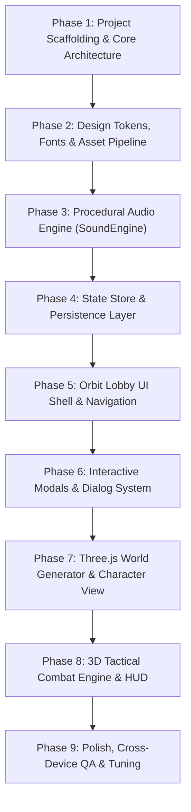

# Prioritized Implementation Plan: Nimbus Salvagers

## 1. Architecture & Recommended Tech Stack

| Component | Recommended Technology | Rationale |
| :--- | :--- | :--- |
| **Build Tool** | **Vite 5+** | Instant HMR, native ES module support, optimized bundling for WebGL assets. |
| **Framework** | **React 18 / 19 + TypeScript** | Strict type safety for complex HUD states, game telemetry, and loadout definitions. |
| **Styling** | **Tailwind CSS + Tailwind Animate** | Direct mapping to verified CSS utility classes and custom color variables. |
| **3D Engine** | **Three.js (r170+)** | Identical underlying WebGL engine for procedural meshes, lighting, and cameras. |
| **Audio** | **Native Web Audio API** | Zero-dependency, lightweight, pure algorithmic synthesizer. |
| **Icons** | **Phosphor Icons React (`@phosphor-icons/react`)** | Exact icon set matching verified SVG paths in the target app. |

---

## 2. Phased Reconstruction Roadmap

---

### Phase 1: Project Scaffolding & Core Architecture
- **Objective:** Establish the development environment with proper TypeScript configurations, asset aliases, and dependencies.
- **Tasks:**
  1. Initialize Vite project with React + TypeScript template.
  2. Install dependencies: `three`, `@types/three`, `@phosphor-icons/react`, `clsx`, `tailwind-merge`.
  3. Configure Tailwind CSS with the project color palette, fonts (`Orbitron`, `Barlow Condensed`, `Manrope`), and custom animations.
  4. Set up clean directory structure:
     - `src/audio/` (SoundEngine)
     - `src/components/` (UI shell, screens, modals, combat HUD)
     - `src/game/` (Three.js world, entities, player controller, weapons)
     - `src/data/` (Subclasses, weapons, destinations, collections, default states)
     - `src/types/` (TypeScript interfaces)
- **Acceptance Criteria:** Development server runs at `localhost:5173` with zero build warnings.

---

### Phase 2: Design Tokens, Fonts & Asset Pipeline
- **Objective:** Configure typography, colors, borders, and vector icons.
- **Tasks:**
  1. Import or self-host fonts: `Barlow Condensed`, `Manrope`, and `Orbitron`.
  2. Place `sky-yard.png` in `public/art/sky-yard.png`.
  3. Implement reusable SVG components:
     - `AirshipLogo` (`viewBox="0 0 48 48"`)
     - `ActivityEmblem` (`viewBox="0 0 56 56"`) with variants for Story, Vanguard, and Wind Trials.
     - `SubclassEmblem` (`viewBox="0 0 48 48"`) with variants for Rigger, Aerostat, and Mistwright.
     - `WeaponBlueprint` (`viewBox="0 0 400 150"`) with continuous and pulse chamber modes.
     - `SailfinIcon` (`viewBox="0 0 64 48"`).
- **Acceptance Criteria:** Typography scales match design specifications across all screen widths.

---

### Phase 3: Procedural Audio Engine (`SoundEngine`)
- **Objective:** Implement the procedural audio synthesizer without requiring external audio files.
- **Tasks:**
  1. Create `SoundEngine` class using `AudioContext` with master volume control.
  2. Implement ambient multi-oscillator drone chord (`[55, 82.41, 110, 164.81] Hz`).
  3. Implement procedural sound effects:
     - `shoot(isHeavy)`: Exponential lowpass noise + sawtooth pitch drop.
     - `hit(isCrit)`: High-frequency sine wave ping.
     - `kill()`: Ascending triangle wave sweep.
     - `reload()`: Noise burst + square click.
     - `ability()`: Sawtooth sweep + filtered noise.
     - `explosion()`: Deep sub-sine drop + heavy noise.
     - `ui()`: 700Hz to 1100Hz upward sine chirp.
     - `win()`: 4-note E-major chord arpeggio.
  4. Handle browser autoplay policies with seamless resumption on user gesture.
- **Acceptance Criteria:** All 8 sound effects and ambient drone play cleanly with adjustable volume and zero clipping.

---

### Phase 4: State Store & Persistence Layer
- **Objective:** Manage persistent player profiles, settings, and live HUD telemetry.
- **Tasks:**
  1. Define TypeScript interfaces for `PlayerProfile`, `Settings`, `HUDState`, `Mission`, `Weapon`, and `Subclass`.
  2. Implement `loadProfile()` and `saveProfile()` for `localStorage` key `nimbus-engineer-v1`.
  3. Wire default initial profile:
     - Subclass: `rigger`, Weapon: `auto`, Spool Tokens: `2500`, Power: `1750`.
     - Unlocked items: `["coil-nine", "pathfinder"]`.
     - Default settings: Volume `0.35`, Sensitivity `1.0`, Quality `"high"`.
  4. Expose `window.__NIMBUS_STATE__` getter for automated testing and verification.
- **Acceptance Criteria:** Profile modifications (e.g. equipping weapons, changing volume) survive page reloads.

---

### Phase 5: Orbit Lobby UI Shell & Navigation
- **Objective:** Build the desktop and responsive lobby interface.
- **Tasks:**
  1. Build `TopBar`: Wordmark logo, 4 navigation buttons with sliding indicator, status beacon, power counter, settings trigger.
  2. Build `PlayScreen`: Hero headline, tracked mission briefing card, engineer preview tile, "Choose your next adventure" 3-card grid.
  3. Build `DestinationsScreen`: Cirrus Reach planetary orbital graphic and 3 detailed mission cards.
  4. Build `EngineerScreen`: Subclass tabs, animated stat bars, 3D character viewport, and kinetic loadout panel.
  5. Build `CollectionsScreen`: 6-card codex grid with rarity borders, discovery counters, and locked/unlocked states.
  6. Build `FooterBar`: Hexagon rank badge with XP progress bar, controls button, sound toggle, and attribution.
  7. Implement responsive CSS breakpoints for Tablet (768px) and Mobile (390px).
- **Acceptance Criteria:** Visual fidelity matches captured screenshots at 1280px, 768px, and 390px viewports.

---

### Phase 6: Interactive Modals & Dialog System
- **Objective:** Implement the 5 modal dialogs with smooth entrance animations.
- **Tasks:**
  1. Create generic `<Modal>` container with backdrop blur, top-right `✕` close button, and `dialog-in` animation.
  2. Build `SettingsModal`: Interactive sliders for volume and sensitivity, quality dropdown, checkboxes for reduced motion and inverted Y, and "DONE" button.
  3. Build `ControlsModal`: Keybinding matrix, Sailfin field guide notes, and "READY, ENGINEER" button.
  4. Build `BriefingModal`: Dynamic mission briefing card with objective, location, duration, and "LAUNCH MISSION" button.
  5. Build `ItemDetailModal`: Expanded vector blueprint schematic, unlock status, and "EQUIP WEAPON" button.
  6. Build `PauseModal`: In-game pause overlay with Resume, Settings, Controls, and Return to Yard.
- **Acceptance Criteria:** All modals open and close cleanly, trapping focus and playing sound effects.

---

### Phase 7: Three.js World Generator & Character View
- **Objective:** Build the procedural 3D Yard and character preview.
- **Tasks:**
  1. Implement `World` class: Three.js `Scene`, `PerspectiveCamera`, `WebGLRenderer`, and directional shadow lighting.
  2. Implement procedural ceramic canvas texture generator (`w1`).
  3. Construct celestial architecture: Stone pillars, Beryl archway, floating rings, portal disc, and mountains.
  4. Implement atmospheric sky dome shader and fog (`#9298a7`).
  5. Build procedural 3D Engineer model with articulated limbs, chest plate, and dome helmet.
  6. Support camera modes: `landscape` (broad vista) and `engineer` (focused character view).
  7. Generate real-time offscreen thumbnails for activity cards.
- **Acceptance Criteria:** Smooth 60 FPS rendering in the lobby with ambient wind and particle motes.

---

### Phase 8: 3D Tactical Combat Engine & FPS HUD
- **Objective:** Complete the tactical combat gameplay loop.
- **Tasks:**
  1. Implement FPS Player Controller: Pointer Lock API, mouse look, WASD movement, sprint multiplier, jumping, gravity, and ground collision.
  2. Implement First-Person Weapon: Gun model attached to camera, ADS camera zoom, firing loop, ammo counters, reload animation, and recoil kick.
  3. Implement Enemy System:
     - Vane Walker AI: Pathfinding toward player, energy projectile attacks, precision optic eye hit detection.
     - Rotor Marshal Boss: Heavy health bar, mortar strikes, shield mechanics.
  4. Implement Wave Manager: Wave 1 (4 enemies) -> Wave 2 (6 enemies) -> Wave 3 (Boss wave).
  5. Implement Combat HUD: Circular radar, health & shield bar, reticle with hit markers, ability tray, and floating damage numbers.
  6. Implement Victory and Defeat triggers: Update stats, award tokens, unlock rewards, and offer return to lobby.
- **Acceptance Criteria:** Full mission can be played from start to finish, with enemies taking damage, player taking damage, shield regenerating, and mission completing upon boss defeat.

---

### Phase 9: Polish, Cross-Device QA & Tuning
- **Objective:** Ensure rock-solid stability, performance, and accessibility.
- **Tasks:**
  1. Audit keyboard navigation and ARIA attributes (`aria-current="page"`, `role="alert"`, `role="status"`).
  2. Validate mobile touch controls (virtual joystick, swipe camera, tap to fire).
  3. Performance optimization: Ensure draw calls remain under 120 and triangle count under 150k.
  4. Verify offline support and WebGL context restoration.
- **Acceptance Criteria:** Zero console errors, responsive on all devices, fully independent rebuild.
