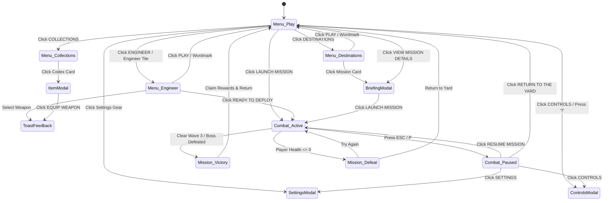

# Interaction & Behavior Specification: Nimbus Salvagers

## 1. Global Navigation & Menu State Machine

The interface operates as a unified state machine transitioning between Orbit Lobby (`"menu"`) and Tactical Combat (`"game"`):

---

## 2. Lobby & HUD Interactions

### 2.1. Tab Navigation & 3D Camera Focus
- **Tabs:** `PLAY`, `DESTINATIONS`, `ENGINEER`, `COLLECTIONS`.
- **Behavior:**
  - Clicking any tab triggers `SoundEngine.ui()` (sine sweep `700Hz -> 1100Hz`).
  - Active button gains `.active` class, shifting the glowing diamond indicator ``.
  - When switching to `ENGINEER`: The background Three.js camera transitions from `landscape` orientation (broad vista view) to `engineer` mode (zoomed framing of the 3D player character model in the Yard).
  - Switching back to `PLAY`, `DESTINATIONS`, or `COLLECTIONS` restores wide-angle vista camera framing.

### 2.2. Activity Card Selection ("Choose Your Next Adventure")
- **Cards Available:**
  1. `story`: **The Beryl Signal** (Campaign · Chapter 01)
  2. `strike`: **Through the Squall** (Vanguard · AI Fireteam)
  3. `windtrials`: **Trial by Wind** (Wind Trials · Vs. Bots)
- **Behavior:**
  - Clicking an activity card sets `mode` state and marks the card with `.selected` (coral border, tick indicator, orange accent bar).
  - The right-side **Tracked Mission Card** instantly re-binds to display the chosen activity's icon, chapter, title, and synopsis.
  - Dynamically updates the CSS custom property `--activity-color` to match the activity palette:
    - Story: `#8898c1` (Aerospace Blue)
    - Strike: `#8eb9c5` (Vanguard Cyan)
    - Wind Trials: `#c98672` (Trial Coral)

### 2.3. Engineer Customization
- **Subclass Selection (Rigger, Aerostat, Mistwright):**
  - Clicking a subclass updates the player's active subclass, re-renders the animated stat progress bars (Mobility, Resilience, Recovery), updates ability descriptions, and immediately changes the 3D character model's colorway and armor shaders in real-time.
- **Weapon Selection (Coil Nine, Rainbell, Longdraft):**
  - Clicking an unlocked weapon card equips it as the active primary.
  - Fires an audible UI confirmation chirp and displays a toast notification for 2.4 seconds (`"${WeaponName} equipped"`).
  - Instantly updates the first-person weapon 3D model and ammo capacities for combat deployment.

### 2.4. Collections Codex
- **Codex Cards (6 total):**
  - Discovered items display full blueprint schematics and checkmark badges.
  - Locked items show lock icons and requirement strings (`"COMPLETE THE ASSOCIATED ACTIVITY TO DISCOVER"`).
  - Clicking any card opens the `ItemDetailModal`:
    - Shows expanded vector wireframe schematic (`Hs` component with animated pulse chamber lines).
    - Unlocked weapons provide an active `"EQUIP WEAPON"` action button.

---

## 3. Modal Lifecycle & Settings Synchronization

### 3.1. Settings Modal Controls
1. **Master Volume Slider:**
   - Controls Web Audio API `masterGain.gain` directly via `AudioParam.setTargetAtTime()`. Range: `0.0 - 1.0` (displayed as `0% - 100%`).
2. **Look Sensitivity Slider:**
   - Multiplies raw mouse movement delta (`movementX`, `movementY`). Range: `0.20x - 3.00x`.
3. **Graphics Quality Dropdown (`low` | `medium` | `high`):**
   - High: 2048x2048 directional shadow maps, dense procedural grass tufts, dynamic post-processing tone mapping.
   - Low: 1024x1024 shadow maps, reduced particle counts, simplified foliage rendering.
4. **Reduce Motion Toggle:**
   - Adds `.reduced-motion` class to root `.game-app` container, disabling ambient float animations and camera bobbing.
5. **Invert Vertical Look Toggle:**
   - Reverses mouse Y pitch control.

All settings persist immediately to `localStorage` under key `nimbus-engineer-v1`.

---

## 4. 3D Combat Simulation & FPS Controls

### 4.1. Tactical Input Mapping

| Key / Input | Action | Game Engine Response (`y4`) |
| :--- | :--- | :--- |
| **`W, A, S, D`** | Horizontal Movement | Computes camera-relative movement vector with acceleration and ground friction. |
| **`Shift` (Hold)** | Sprint | Multiplies movement speed by `1.5x`, increases camera field of view by `+4°`. |
| **`Space`** | Jump | Applies vertical impulse vector (`verticalVelocity = 8.5 m/s`). Gravity applies `-19.6 m/s²`. |
| **`Mouse Move`** | Look Around | Rotates camera yaw and pitch via Pointer Lock API. Pitch is clamped to `[-85°, +85°]`. |
| **`Left Click`** | Fire Weapon | Fires Raycast projectile from camera center. Emits muzzle flash light, kicks camera recoil, triggers `SoundEngine.shoot()`, decrements ammo. |
| **`Right Click` (Hold)** | Aim Down Sights (ADS) | Transitions camera FOV from `58°` down to `42°`, centers weapon model along sightline, tightens reticle. |
| **`R`** | Reload | Triggers reload animation sequence (`1.65s` for auto rifle), plays reload sound, restores magazine from reserve. |
| **`Q`** | Class Ability | Executes subclass ability (e.g. Rigger "Updraft Step": instant tactical reload + scorch evasion dodge). |
| **`E`** | Elemental Grenade | Spawns physical grenade projectile with arc trajectory that detonates on impact dealing radial splash damage. |
| **`F`** | Super Ability | Activates Suncoil / Storm Drum / Rainburst when super charge reaches `100%`. Empowers weapon damage for 10s. |
| **`1, 2, 3`** | Switch Weapons | Cycles through equipped primary, special, and heavy weapons. |
| **`ESC` or `P`** | Pause Mission | Halts simulation tick, exits pointer lock, and displays in-game pause dialog. |

### 4.2. Combat Mechanics & Vitality Rules
- **Health & Shield Breakdown:**
  - Maximum Health: `100 HP` (vitality bar).
  - Protective Shield: `75 HP` (plasma overshield).
- **Damage Priority:** Incoming enemy fire depletes shield first. Once shield is broken, damage directly hits core health.
- **Shield Regeneration Rule:** Taking damage resets the internal timer `sinceDamage = 0`. If the player avoids taking damage for **4.0 consecutive seconds**, shield regenerates at `25 HP/second` until fully restored.
- **Precision Critical Hits:** Enemy "Vane Walkers" possess a central glowing optical eye. Raycasts striking this hit-box trigger critical hit multipliers (`2.5x` damage), emit golden floating damage text, and play `SoundEngine.hit(isCrit = true)`.

### 4.3. Wave Progression & Enemy AI
1. **Wave 1 of 3 ("Clear the Turbine from the Beryl ruins"):**
   - 4 Vane Walkers materialize from the Beryl Gate.
   - Walkers navigate toward player using path smoothing, maintaining optimal firing distance, and discharging energy bolts.
2. **Wave 2 of 3:**
   - 6 Vane Walkers with increased movement agility.
3. **Wave 3 of 3 (Boss Wave):**
   - 4 Vane Walkers + **Rotor Marshal** (Enlarged flying mech boss).
   - Rotor Marshal has a top boss health bar (`bossHealth`), periodic shield pulses, and high-damage plasma mortar attacks.
4. **Mission Completion:**
   - Upon defeating the Rotor Marshal, combat terminates, victory fanfare plays (`SoundEngine.win()`), tokens and score are awarded, and the corresponding item reward (`Rainbell` hand cannon) is unlocked in Collections.
